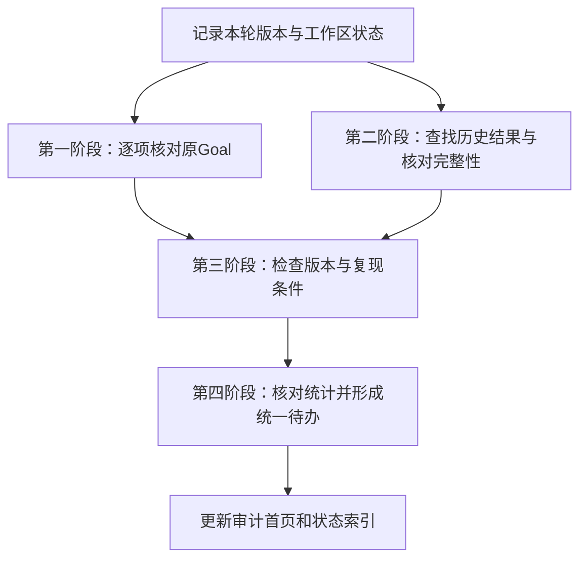

# 原Goal接续核查实施方案

编制日期：2026年9月26日。

工作目录：`/home/linux/Documents/MSM`。

编制依据：[Goal断点复核与后续建议](20260926/Goal断点复核与后续建议_CN.md)、[原Goal历史断点与后续计划](20260926/原Goal历史断点与后续计划_CN.md)及现有报告证据索引。

执行状态：2026年9月26日，第一阶段的[原Goal60项主级对照](goal_resume_audit_20260926_v1/原Goal逐项状态对照_CN.md)、第二阶段的[450组本地定位与来源文件字节校验](goal_resume_audit_20260926_v1/历史结果定位与完整性核对_CN.md)已有产物。随后完成第三阶段的[11类重点记录版本与复现条件核查](goal_repro_stats_audit_20260926_v1/版本对应与复现条件_CN.md)，以及第四阶段的[选定统计检查和问题登记](goal_repro_stats_audit_20260926_v1/统计口径与记录问题清单_CN.md)，形成[12项后续待办](goal_repro_stats_audit_20260926_v1/后续工作清单_CN.md)。模块所有者复核、缺失归档恢复、完整依赖闭包及其他历史批次仍未完成。核查完成不代表原Goal完成。

后续补证：同日完成[16份源码保存、静态依赖及45组搜索配置核对](goal_evidence_followup_20260926_v1/来源版本补证与后续安排_CN.md)，并形成[统计口径说明和原文修订建议](goal_evidence_followup_20260926_v1/统计口径说明与报告修订清单_CN.md)。本轮没有同步修改原报告或实验清单。执行状态以[更新后的12项待办](goal_evidence_followup_20260926_v1/NEXT_ACTIONS.csv)为准，之前的批次保留为历史快照；完整版本还原、模块所有者复核及450组归档恢复仍未完成。

模块复核阶段：随后已完成[7个模块所有者及main的60项逐项复核、四份报告Word与Markdown说明同步](goal_owner_review_sync_20260926_v1/模块复核与报告同步结论_CN.md)。完成分类不变，历史证据说明另存[复核后登记表](goal_owner_review_sync_20260926_v1/GOAL_REQUIREMENT_EVIDENCE_REVIEWED.csv)，旧表和原始实验清单保留。D2哈希对象对应已查明，450组完整载荷仍未定位；当时尚需所属模块衔接当前文档入口，并继续处理来源和环境缺证据事项。该阶段待办保存在[阶段清单](goal_owner_review_sync_20260926_v1/NEXT_ACTIONS.csv)。

文档同步阶段：D3至D6及主级的[文档状态同步](goal_module_status_sync_20260926_v1/模块状态文档同步结果_CN.md)已完成。44份既有文档仅增加当前说明，历史正文原样保留，新增4份集中状态页；120处链接和上一批8份汇报文件保护检查通过。A11入口同步已完成，当时安排保存在[阶段待办](goal_module_status_sync_20260926_v1/NEXT_ACTIONS.csv)。原Goal完成分类和450组完整记录未定位状态不变，该批未运行训练、仿真或模块算法。

工具维护阶段：[普通统计记录防护维护](statistics_record_guard_20260926_v1/普通统计记录防护维护结果_CN.md)完成审计入口改造，87项普通工具测试通过。A07仍为部分完成，原实验汇总函数的边界问题未修改；新检查需明确配置完整键及可空字段，不自动追认历史数据。该批未重算实验结果，当时事项保存在[阶段待办](statistics_record_guard_20260926_v1/NEXT_ACTIONS.csv)。

保存表检查阶段：已完成[6份保存表的规则配置与实际检查](saved_table_validation_20260926_v1/保存记录规则应用与检查结果_CN.md)，3615条保存记录通过结构及分组数量检查，1020处允许空值逐行登记，源表未变；102项普通工具测试通过。A07的选定来源配置验证完成，原函数修复仍未进行，整体状态维持部分完成。该阶段安排见[当时待办](saved_table_validation_20260926_v1/NEXT_ACTIONS.csv)。

最新进展：已完成三个已登记批次的[历史源码与运行环境缺项核对](source_environment_gaps_20260926_v1/历史源码与运行环境缺项核对_CN.md)。没有找到新的历史源码副本或完整环境导出；71条“批次—源码”记录中有16条历史哈希依据，55条静态候选仍需原批次版本依据。这是按批次登记的候选数，不是独立缺失文件数或实际运行依赖数。中心误差批次保存的四包环境摘要不能作为完整环境锁定，其记录声明使用CPU、未运行AirSim。六项具体补证要求见[材料清单](source_environment_gaps_20260926_v1/MATERIAL_REQUESTS.csv)，最新安排见[本批待办](source_environment_gaps_20260926_v1/NEXT_ACTIONS.csv)。A02、A03、A12仍有证据缺项，取得原批次源码、环境材料或明确备份线索后再定向核对；没有新线索，不重复扫描已查目录。原Goal完成分类及450组“摘要可查、完整记录未定位”状态不变。本批未重算结果、运行模型或仿真。

以上各段保留阶段先后关系，已完成的盘点、说明同步、6份表的配置检查及本批定向缺项核对不重复执行。

## 一、工作目标与范围

本轮工作对原Goal逐项建立要求、实现、结果与结论之间的对应关系，查明历史证据是否完整、后续成果是否改变原有状态，以及哪些结果具备复现条件。完成后形成统一的状态表、缺失证据清单和后续待办，供继续安排工作时使用。

实施范围为历史记录核对、文件与版本追溯、数据完整性检查及通用统计软件检查。模型与配置只检查文件及元数据；本方案不安排自主拦截策略训练、制导优化或控制链路运行。原Goal中的相关未完成事项按历史要求登记，不因本轮审计完成而改判为完成。

## 二、核查起点

以下状态取自2026年9月26日05:56的复核记录。正式执行时重新记录分支、提交和工作区变化；磁盘容量等动态信息以执行时检查为准。

| 项目 | 已核实状态 | 本轮处理方式 |
| --- | --- | --- |
| 原Goal | 2026年7月20日建立；8月8日UTC记录执行`/goal clear` | 保留历史起止记录，不将清除操作记为任务完成 |
| 原专项分支 | `feat/scalable-3d-200v200`，末端提交`98fd397` | 作为历史实现参照 |
| 当前分支 | `exp/d5-ideal-20target-registration`，复核时HEAD为`a0d3d8a` | 已包含原专项分支，不为查证回退工作区 |
| 来源生成及审计 | D3、D4、D5合计728组，独立来源审计通过 | 检查现存清单和文件完整性，维持原结论范围 |
| 正式规则试验 | 历史记录为450/900，原`/tmp`结果路径失效 | 查找同批次归档，分别登记结果和摘要可用性 |
| 后续独立试验 | 存在双光电、搜索、中心与机间配准等结果 | 核对其与原Goal的引用、接入及验证关系 |
| 资料审计 | 已完成两阶段登记，包含1304个表格单元格核对 | 引用已有索引，新增检查集中在原Goal对应关系和缺失证据 |
| 存储 | 复核时系统盘可用约25G，独立备份已按用户要求跳过 | 优先查索引和清单，大文件校验顺序执行，避免无计划复制 |

728组来源数据和450组正式试验属于不同批次。报告数量、表格行数、来源数量和独立试验数量分别记录，不计算统一的项目完成百分比。

## 三、阶段安排

第一、第二阶段优先开展。第三阶段可先处理已找到完整材料的条目，其余条目保留待查状态。第四阶段以已经核实的证据为依据形成结论，缺失证据明确列为未解决事项。

### 第一阶段：逐项核对原Goal

**目的：** 查明原目标每一项要求的当前状态，明确后续独立成果是否已经被原项目实际采用。

实施步骤：

1. 从原Goal历史、完成度审计和8月7日进展文档提取要求，为每项建立稳定编号，保存原始出处和日期。
2. 分别登记实现文件、测试记录、输入来源、保存结果和结论文档。只有接口、演示或方案文字的，按实际范围记录。
3. 对照原专项分支与当前分支，查找后续变化。Git提交用于定位代码变化，不能单独证明实验已完成。
4. 对后续独立试验，分别判断“独立存在”“被文档引用”“有接口接入证据”“有统一验证证据”。每一项都附对应文件，没有依据的记为未确认。
5. 主智能体汇总状态，模块所有者复核与自身目录相关的条目。存在分歧时登记双方依据，不先修改原模块结论。

状态统一使用四种表述：

| 状态 | 判定依据 |
| --- | --- |
| 已完成 | 对该项原要求，有范围相符的实现及验证记录 |
| 部分完成 | 只满足部分范围、版本、规模或验证条件 |
| 未完成 | 原记录明确未实施，且未找到后续完成证据 |
| 证据不足 | 有完成描述，但无法确认对应原始记录或适用范围 |

状态表至少包含：要求编号、原始要求、原始出处、最后证据日期、代码或结果路径、执行版本、后续变化、当前状态、未解决事项和负责人。

**产物：** `原Goal逐项状态对照_CN.md`及`GOAL_REQUIREMENT_EVIDENCE.csv`。

**完成标准：** 原要求逐项有记录；每条“已完成”均可定位证据；独立试验与原集成研究的关系没有混写；历史测试结果注明原执行日期。

### 第二阶段：查找历史结果与核对完整性

**目的：** 定位450组正式试验的可用记录，并确认三个来源目录的保存状态。

实施步骤：

1. 先查询现有文件盘点、保留登记和历史归档说明，再对候选目录进行定向查找。避免反复遍历全部实验输出。
2. 以原批次标识、运行编号、配置摘要、种子集合、记录数和清单校验值判断归档身份。目录名相近只能作为查找线索。
3. 对压缩包先读取成员清单，检查是否包含所需文件。不自动解压整个归档，也不执行归档内脚本。
4. 对D3、D4、D5来源，按原清单核对文件存在性、大小和已有校验值；分模块记录检查进度。只有确实完成全部载荷校验，才写为“本轮完整校验通过”。
5. 分别登记旧路径、现存路径、完整性、校验范围和差异。发现多个候选副本时保留各自信息，不能直接拼接成一个运行目录。
6. 未找到完整记录时，统一登记“摘要可查、完整记录未定位”，不以重新生成数据填补原批次。

查找重点包括：

- 正式450组试验的清单、分片记录、归档及逐组结果；
- D3、D4、D5现存来源的会话、进度、完成记录及载荷清单；
- 历史来源审计文件与其声明检查的数据版本是否一致。

**产物：** `历史结果定位与完整性核对_CN.md`、`ARCHIVE_LOCATION_REGISTER.csv`及`SOURCE_INTEGRITY_CHECKS.csv`。

**完成标准：** 每个候选归档均有批次判断依据；找到、部分找到、未找到分别列示；原审计通过与本轮文件校验明确区分。核查完成不要求缺失数据已经恢复。

### 第三阶段：检查版本与复现条件

**目的：** 明确哪些结果可以根据现存材料复现，以及仍缺少哪些条件。

对每个结果检查以下要素：

| 要素 | 检查内容 |
| --- | --- |
| 执行源码 | 历史提交、当时未提交修改、源码快照或文件哈希 |
| 配置与命令 | 保存的参数、配置文件、随机种子及实际运行入口 |
| 输入 | 原始观测或保存数据、清单、文件哈希、训练与评价用途记录 |
| 模型 | 文件、配置、权重摘要及对应训练记录；只核查元数据 |
| 环境 | 依赖版本、仿真器版本及影响结果的运行设置 |
| 结果与评价 | 逐组记录、汇总方式、统计时间窗、分母及失败项处理 |

复现条件分为四类：原样重运行的前提是否齐备、能否依据保存数据离线回放、能否仅重新汇总已有计数、是否只能查阅摘要。每类分别给出“具备”“缺少条件”或“无法确认”，不因一种方式可行而推定另一种方式也可行。

本阶段只核对条件，不启动实验、加载模型或重新评分。历史命令原样保存为出处；有缺失参数时逐项说明，不补写成看似完整的已执行命令。

**产物：** `版本对应与复现条件_CN.md`及`REPRODUCIBILITY_REGISTER.csv`。

**完成标准：** 每项结果均能说明源码、输入和环境的可用情况；当前HEAD没有被冒用为历史执行版本；已用于选参或查看的数据没有重新标为未见数据。

### 第四阶段：核对统计并形成统一待办

**目的：** 消除记录和表述中的歧义，给出后续工作的明确范围。

先检查通用记录与统计逻辑：

| 检查项 | 具体问题 |
| --- | --- |
| 缺失值 | 未运行、运行失败、文件缺失是否被错误写成零 |
| 分母 | 最后一圈、全程累计、固定目标数和有效输出数是否混用 |
| 重复计数 | 同一seed在不同方法、干扰和参数组合中重复出现，是否被算作独立样本 |
| 超时 | 超时后的质量结果和规定时间内结果是否分别记录 |
| 时间与单位 | 量测时刻、到达时刻、时间基准、角度与距离单位是否明确 |
| 历史比较 | 同批次对照、跨版本诊断和同数据选参是否作出区分 |

必要的软件检查使用人工构造的普通记录，不调用项目的目标分配、配准或控制链路。发现问题后保存输入、预期输出和实际输出，先建立问题记录；涉及模块代码的修复由对应所有者按仓库规则承担。

在核查结果基础上形成统一待办。每项写明问题、依据、影响范围、负责人、前置条件和完成标准。缺失证据、文档不一致、统计软件问题和原研究未完成项分别登记。

**产物：** `统计口径与记录问题清单_CN.md`、`后续工作清单_CN.md`和`NEXT_ACTIONS.csv`。

**完成标准：** 待办与证据逐项对应；重复事项已合并；没有通过改写历史结果消除问题；未完成项保留准确状态。

## 四、人员分工与并行方式

主智能体负责原Goal要求提取、Git与会话记录核对、主索引及最终报告。需要并行时，可安排两项只读任务：一项核对原要求与后续成果，一项定位归档与核对文件完整性。大文件校验控制并发，避免磁盘争用。

D1至D7模块内部的实现解释和文档变更由对应模块所有者负责。创建模块子智能体前读取`agents/README.md`及角色文件，任务中明确拥有的路径、只读范围和检查要求；并发不超过6个，完成后及时关闭。

本次编制方案不创建子智能体，也不修改模块README、PLAN、GAP或review。后续证据确需改变模块状态时，模块所有者按仓库规定同步相关说明，主智能体核对跨模块表述。

## 五、产物存放与过程记录

实施时在审计目录下创建新的批次目录，例如`goal_resume_audit_YYYYMMDD_v1/`；日期取实际执行日，已存在时使用新版本号。文件名写入清单，不覆盖此前审计。

每批记录执行时间、基线提交、开始与结束状态、检查范围、已检查数量、发现的问题和最后完成位置。运行中断后，先核对该批记录与输出完整性，再继续未完成部分。

历史文档保持原日期和结论。审计首页链接最新状态，旧快照保留其原有用途。现有人工修改、未跟踪资料及实验载荷原位保留；提交、推送和资料清理不在本次方案编制范围内。

## 六、首批任务与结束条件

首批优先完成以下工作：

1. 将原Goal要求整理为逐项状态表，列出已有证据与缺失证据。
2. 查找450组正式试验的归档，判断能否定位到同一批次的完整记录。
3. 核对D3、D4、D5来源的完成记录与文件清单，明确后续完整校验范围。
4. 登记后续独立试验与原Goal之间已有的引用和接入证据。

首批结束时应能够回答：原Goal哪些要求有完成证据，哪些只完成了部分范围；450组历史数据保存在哪里；哪些后续成果确实改变了原断点；还缺哪些文件才能判断复现条件。

全轮核查结束时，统一状态表、归档定位表、复现条件表和后续待办应相互对应。可以确认的结论写明依据，尚不能确认的保留原因。审计完成与原Goal完成分别记录。

## 七、主要材料入口

- [Goal断点复核与后续建议](20260926/Goal断点复核与后续建议_CN.md)
- [原Goal历史断点与后续计划](20260926/原Goal历史断点与后续计划_CN.md)
- [工作线状态对照](20260926/工作线状态对照_CN.md)
- [数据保留与归档登记](20260925_preservation_v1/数据保留与归档登记_CN.md)
- [逐文件盘点清单](20260925_preservation_v1/FILES.jsonl.gz)
- [报告与原始记录对应索引](20260926_stage2_evidence_v1/报告与原始记录对应索引_CN.md)
- [原Goal实施进展](../../research_modules/scalable_3d_simulation/docs/SCALABLE_3D_GOAL_PROGRESS_AND_NEXT_PLAN_20260807_CN.md)
- [原Goal完成度审计](../../research_modules/scalable_3d_simulation/docs/SCALABLE_3D_GOAL_COMPLETION_AUDIT_20260803_CN.md)
